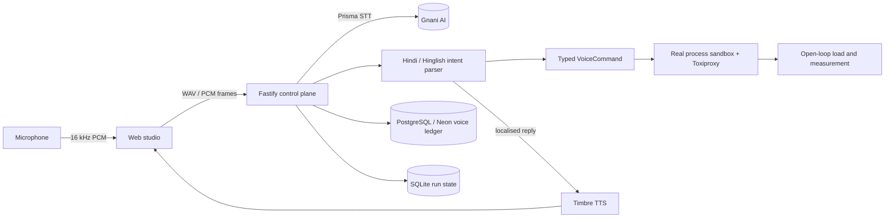

# EchmaMeet: say it in Hindi, break it for real

**Voice-first chaos engineering for Indian engineering teams, powered by Gnani AI.**

Speak a command in Hindi, English or Hinglish. EchmaMeet hears it with **Gnani Prisma**, turns it into a strictly typed chaos action, injects the fault into a **real multi-process sandbox** (physical TCP sockets, Toxiproxy), measures what actually happens, and answers you out loud in your own language with **Gnani Timbre**.

> "gateway se backend par teen sau millisecond latency inject karo"
> → Prisma transcribes (`transcribe` mode keeps `gateway`, `backend` and `300 ms` clean) → the parser resolves the edge → the sandbox injects 300 ms → Timbre replies in Hindi: _"गेटवे से बैकएंड लिंक पर लेटेंसी फॉल्ट डाला जा रहा है, 300 मिलीसेकंड।"_

Built for the **Great Indian AI Internship Challenge by Gnani.ai**.

---

## Why this is different

Most voice demos stop at "speech in, text out". EchmaMeet closes the loop on something that has consequences: **the spoken command changes a running distributed system, and the result is measured, not guessed.**

| Layer         | What it does                                                                                                                       | Gnani piece                    |
| ------------- | ---------------------------------------------------------------------------------------------------------------------------------- | ------------------------------ |
| Hearing       | Push-to-talk (REST) and hands-free (WebSocket streaming) transcription of Hindi, English, Hinglish and 7 more Indian languages     | **Prisma v3.0** (`indic-auto`) |
| Understanding | Deterministic English/Hindi/Hinglish intent parser: Devanagari service names, Hindi number words ("तीन सौ" → 300), unit conversion | Prisma `transcribe` format     |
| Doing         | Real fault injection and open-loop load against real processes; repair accepted only if re-measurement improves beyond noise       | none (it is the product)       |
| Speaking      | Confirmations and the SRE agent's opinions spoken in the language you used                                                         | **Timbre v2.5 / v3.0**         |
| Remembering   | Every command, language, STT/TTS latency and outcome in **PostgreSQL (Neon)** with live analytics                                  | none                           |

Nothing here needs an LLM. Hazard analysis is a deterministic rule engine, repair diagnosis is a trained random-forest model plus rules. An open-weight **Gnani Evon** endpoint can optionally be plugged in (`EVON_BASE_URL`), and the system falls back to the rule engine if it is absent or fails.

---

## How Gnani is used

| Capability               | Endpoint                                                | Where                                                                           |
| ------------------------ | ------------------------------------------------------- | ------------------------------------------------------------------------------- |
| Push-to-talk STT         | `POST /stt/v3` (multipart, `X-API-Key-ID`)              | `apps/server/src/modules/gnani/infrastructure/gnani-stt-client.ts`              |
| Hands-free streaming STT | `wss://…/stt/v3/stream` (1024-byte frames, VAD headers) | `…/gnani-realtime-stt.ts`, bridged by `voice/infrastructure/voice-ws-bridge.ts` |
| Meeting transcription    | `POST /stt/v3` on 5 s WAV chunks, `indic-auto`          | `meeting/routes.ts`                                                             |
| Text-to-speech           | `POST /api/v1/tts/inference` (WAV)                      | `…/gnani-tts-client.ts`                                                         |

Details that matter in production, all covered by tests:

- **Browser audio is converted to 16 kHz mono WAV** in an AudioWorklet. Gnani's REST API does not accept WebM, so the server sniffs the container and rejects unsupported audio **before spending credits**.
- **Streaming proxy**: browsers cannot set WebSocket headers, so the server holds the API key, re-frames arbitrary PCM chunks into exact paced 1024-byte frames, pads silence on release so the VAD closes the segment, and escapes Indic `x-keyterms` as ASCII JSON.
- **Domain biasing**: node labels and terms like "circuit breaker" are sent as `keyterms`, so your own service names are recognised.
- **Resilience**: full-jitter exponential backoff on 429/5xx/timeouts, no retry on auth errors, automatic fall-back from Prisma v3.0 to v2.5 if the account is not enabled for v3.0, speech output that can never break a command.
- **Telephony-ready**: an 8 kHz session applies the documented telephony VAD preset.

---

## Architecture



A modular monolith with enforced boundaries (`pnpm boundaries`): `gnani`, `voice`, `voice-ledger`, `reasoning`, `meeting`, `repair`, `experiments`, `sandbox`, `chaos`, `measurement`, `runs`, `topology`, `reporting`, `benchmarks`, `vision`. Each is reachable only through its `index.ts`.

**Storage**: experiment state stays in embedded SQLite (deterministic, zero latency for the chaos engine). The voice ledger lives in PostgreSQL when `DATABASE_URL` is set (Neon works out of the box, TLS on, advisory-locked versioned migrations) and in a bounded in-memory ring otherwise. The server log states which one is active; it never pretends.

---

## Quick start

Prerequisites: Node `^22.13`, pnpm `12.13`, and optionally [Toxiproxy](https://github.com/Shopify/toxiproxy) on `:8474` for physical network faults.

```bash
pnpm install
cp .env.example .env        # then set GNANI_API_KEY and, optionally, DATABASE_URL
pnpm smoke:gnani            # Timbre -> Prisma round trip: verifies your key end to end
pnpm dev                    # web http://localhost:5173, API http://localhost:8787
```

Docker: `cd infra && docker compose up`, then open `http://localhost:3000`.

Minimal `.env`:

```bash
GNANI_API_KEY=...                       # https://app.gnani.ai/voice
DATABASE_URL=postgresql://...neon.tech/neondb?sslmode=require   # optional
```

### Demo script (90 seconds)

1. Load a scenario (retry storm) onto the canvas.
2. Open the **Voice** drawer, choose **Hinglish**, hold the mic: _"gateway se backend par 300 ms latency inject karo"_.
3. Watch the typed command card, hear the Hindi confirmation, confirm and run the experiment by voice: _"पाँच ट्रायल के साथ एक्सपेरिमेंट चलाओ"_.
4. Say _"रिपेयर शुरू करो"_: the repair loop proposes a bounded policy patch and re-measures it.
5. Turn on **hands-free** and give two commands back to back. Open the **Voice ledger** card to see language mix, success rate and STT p50/p95 from PostgreSQL.
6. Join a review room, speak Hindi: the agent transcribes the room with Prisma and raises a hand, in Hindi, when it finds a hazard.

---

## Supported spoken commands

| Intent         | English                                         | Hindi / Hinglish                                    |
| -------------- | ----------------------------------------------- | --------------------------------------------------- |
| Inject fault   | "inject 300 ms latency from gateway to backend" | "gateway se backend par 300 ms latency inject karo" |
| Run experiment | "run experiment with 5 trials"                  | "५ ट्रायल के साथ एक्सपेरिमेंट चलाओ"                 |
| Start repair   | "start repair"                                  | "रिपेयर शुरू करो" / "repair shuru karo"             |
| Load scenario  | "load scenario 3"                               | "सीनेरियो 3 लोड करो"                                |
| Set invariant  | "set p99 threshold to 400"                      | "p99 थ्रेशोल्ड 400 सेट करो"                         |
| Cancel         | "cancel"                                        | "रोको" / "rok do"                                   |

Ambiguous targets ("latency on backend" when two links match) are answered with a clarifying question, never guessed. Other Indian languages are transcribed by Prisma; adding command vocabulary for them is a data-only change in `voice/domain/lexicon.ts` and `replies.ts`.

---

## API additions

| Route                                   | Purpose                                                             |
| --------------------------------------- | ------------------------------------------------------------------- |
| `POST /api/voice/parse`                 | audio (WAV base64) or text → typed command, optional spoken reply   |
| `WS /ws/voice`                          | hands-free streaming session (`start`, binary PCM, `end_utterance`) |
| `POST /api/gnani/stt` · `/tts`          | thin, authenticated proxies (the key never reaches the browser)     |
| `GET /api/gnani/health` · `/languages`  | configuration status and the language/voice catalogue               |
| `GET /api/voice/history` · `/analytics` | PostgreSQL-backed ledger and aggregates                             |
| `GET /api/reasoning/health`             | shows whether the optional Evon endpoint is active                  |

---

## Quality

```bash
pnpm check     # typecheck, ESLint + Prettier, dependency boundaries, architecture graph, docs, unit tests
```

- 266 server tests (plus 3 PostgreSQL tests when `TEST_DATABASE_URL` is set) including an end-to-end WebSocket test against a fake Gnani streaming server (frame sizes, headers, auth, transcript → intent → Timbre reply → ledger) and PostgreSQL migration/analytics tests (`TEST_DATABASE_URL=postgresql://… pnpm test` runs them against a real database).
- Boundary rules are enforced by dependency-cruiser; the architecture graph is generated and checked.

## Honest limitations

- Whiteboard-photo → topology needs a vision model, and Gnani offers speech models only, so that path is disabled. Red-stroke gesture detection (deterministic) and canvas drawing still work.
- Spoken command vocabulary covers English, Hindi and Hinglish. Marathi shares Devanagari and many words but is not separately tested.
- Gnani Evon is open-weight and not on the hosted API; it is optional and self-hosted only.
- `benchmarks/predictions/*.json` are bundled fixtures of an earlier prediction run, relabelled `static-predictor-fixture`; regenerate them with `pnpm benchmark` and an Evon endpoint if you want live predictions.
- Browser microphone capture needs a secure context (`https` or `localhost`).

## Repository map

```
apps/server     Fastify control plane (modules/gnani, voice, voice-ledger, meeting, repair, …)
apps/web        React studio (audio/ = PCM capture, WAV, playback; features/voice)
apps/loadgen    open-loop load generator
apps/worker      real service processes and job execution
packages/       contracts (Zod schemas), shared
scripts/smoke   gnani.ts (round trip), toxiproxy.ts, ws.ts
docs/           plan, decisions, architecture graph, benchmark results
```

MIT licensed.
