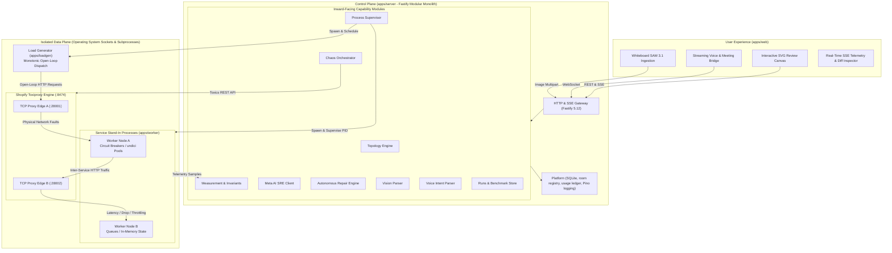

<div align="center">

# EchmaMeet

**Autonomous Collaborative Architecture Review & Design-Time Chaos Engineering Platform**

_Draw distributed systems, inject real physical network chaos, verify declarative invariants under open-loop synthetic load, and autonomously heal architectural vulnerabilities in live review meetings using Meta AI._

[](tsconfig.base.json)
[](package.json)
[](pnpm-workspace.yaml)
[](apps/web/package.json)
[](apps/server/package.json)
[](https://github.com/Shopify/toxiproxy)
[](.dependency-cruiser.cjs)
[](https://dev.meta.ai)
[](LICENSE)

---

[Key Capabilities](#key-capabilities) • [System Architecture](#system-architecture) • [Meta AI SRE & Multimodal Integration](#meta-ai-sre--multimodal-integration) • [Benchmark Suite](#benchmark-suite) • [Quick Start](#quick-start) • [Configuration](#configuration) • [Developer Commands](#developer-commands) • [Limitations & Soundness](#limitations--soundness)

</div>

---

## Executive Overview

Distributed system failure modes—such as cascading retry storms, thread exhaustion under latency spikes, queue memory bloat, and premature circuit breaker trips—are notoriously difficult to detect before production. Static linters cannot capture runtime socket dynamics, while staging environments are high-friction, costly, and rarely subjected to destructive chaos testing.

**EchmaMeet** bridges this gap by bringing **physical chaos engineering directly into design time**:

1. **Draw or Scan**: Architects design system topologies on an interactive SVG canvas or ingest napkin sketches and whiteboard photos via Meta Llama 3.2 Vision.
2. **Materialize**: EchmaMeet provisions standalone Node.js operating-system processes (`apps/worker`) communicating over real loopback TCP/HTTP sockets with Shopify Toxiproxy inline on every edge.
3. **Stress & Break**: An open-loop synthetic load generator (`apps/loadgen`) dishes monotonic drift-corrected Poisson/constant request schedules, while Toxiproxy injects latency, jitter, connection drops, and bandwidth throttling.
4. **Evaluate Invariants**: Declarative architectural contracts (e.g., end-to-end $p_{99} \le 500\text{ ms}$, completion rate $\ge 99\%$, zero duplicate commits) are evaluated across repeated trials with statistical medians and interquartile ranges (IQR).
5. **Autonomously Heal**: When an invariant is violated, a tool-calling Meta model agent analyses raw telemetry, diagnose root causes, and propose targeted resilience repairs from a bounded, typed catalog (adaptive timeouts, exponential backoff with jitter, half-open circuit breakers, queue high-water marks, idempotency tokens).
6. **Empirically Verify**: EchmaMeet re-executes the chaos experiment in the real sandbox. A repair is accepted **only if** empirical measurements improve beyond statistical noise (IQR) and no secondary invariants break.

---

## Key Capabilities

### ⚡ Physical Sockets & Real Operating System Processes

EchmaMeet is **not a discrete-event mathematical simulation**. It spawns real Node.js processes on the operating system. Inter-service traffic traverses physical TCP sockets, exercises Node's HTTP networking stacks (powered by pinned `undici`), allocates real memory buffers, and experiences true operating system scheduling and garbage collection.

### 🎯 Open-Loop Load Generation (Zero Coordinated Omission)

Traditional closed-loop benchmarking tools artificially under-report tail latency by waiting for prior responses before dispatching the next request ("coordinated omission"). EchmaMeet's `apps/loadgen` uses a high-resolution monotonic timer loop (`process.hrtime.bigint()`) with drift compensation. It calculates duration from scheduled offset ($\text{completedNs} - \text{targetNs}$), capturing authentic queue bloat and latency cascades.

### 🤖 Autonomous Meta AI SRE Copilot & Empirical Repair Loop

- **Multi-Turn Diagnosis**: Ingests telemetry, error codes, and invariant metrics to hypothesize root-cause failure mechanisms.
- **Typed Catalog Bounds**: Proposals strictly conform to `packages/contracts/src/catalog.ts` (e.g., maximum backoff $\le 30{,}000\text{ ms}$, circuit breaker trip thresholds $1\text{--}100$). The model cannot inject arbitrary code.
- **Re-Measurement Verification**: Before/after differential reports prove whether an invariant was restored. If the trade-off is insurmountable (e.g. CAP theorem partition), EchmaMeet provides an honest trade-off analysis.

### 👁️ Whiteboard & Diagram Computer Vision (Meta Llama 3.2 Vision)

Architectural reviews frequently start on physical whiteboards. EchmaMeet allows uploading or photographing sketches:

- Meta Llama 3.2 11B Vision (`meta-models/llama-3.2-11b-vision` / `llama-3.2-11b-vision-preview`) extracts service boundaries, queues, databases, and directional arrows into structured topology drafts.
- Gesture-Based Fault Selection: Built-in deterministic RGB color-threshold polyline detection ($R>130, G<110, B<110$) identifies red pen marker strokes across edge paths to select and inject faults directly from the physical whiteboard.

### 🎙️ Live Architecture Review Voice Bridge

EchmaMeet includes an active meeting copilot. Engineering teams can conduct live architecture reviews while the streaming audio WebSocket bridge (`/ws/voice`) transcribes discussion, detects anti-patterns (e.g., "we will just retry immediately on failure"), triggers real-time visual hazard warnings on canvas edges, and allows voice-driven chaos execution.

### 🗄️ Zero-Dependency Local Storage & Enterprise Security

- **Persistence**: Out-of-the-box native SQLite via Node 22 (`node:sqlite`) for deterministic single-host execution and offline reliability.
- **Execution Fabric**: In-process synchronous execution and process supervisor with host Toxiproxy chaos injection.
- **Security**: Server-verified Google/Firebase and GitHub sign-in, HMAC-SHA256 JWT sessions (unique `jti`, production secret required), durable room membership with owner lock, sender-stamped chat and signaling, per-connection rate limiting, and short-lived per-user TURN credentials. No built-in demo credentials exist unless `ALLOW_DEV_MOCK_AUTH` is set outside production.
- **Real-time**: Persistent rooms (canvas operations and snapshots survive restarts), a reconnecting WebSocket with replay from the last seen sequence, and a perfect-negotiation WebRTC mesh verified against a real WebRTC stack (see `apps/server/src/platform/tests/webrtc-real.test.ts`). Mesh topology: designed for small review rooms (default cap 8), not webinars.

---

## System Architecture

EchmaMeet implements a clean separation between an **orchestrating control plane** and an **isolated data plane**, enforced continuously by Dependency Cruiser rules with zero exceptions.



### Monorepo Workspaces & Boundaries

| Workspace            | Type          | Responsibilities                                                                                                                           | Enforced Rule                                                      |
| :------------------- | :------------ | :----------------------------------------------------------------------------------------------------------------------------------------- | :----------------------------------------------------------------- |
| `packages/contracts` | Pure Library  | Zod schemas, TypeScript types, and the bounded numeric catalog (`catalog.ts`). Zero runtime logic.                                         | Cannot import any other workspace.                                 |
| `packages/shared`    | Pure Library  | Seeded PRNG, monotonic clock ports, typed Result monads, domain error hierarchies.                                                         | Imports only standard library.                                     |
| `apps/server`        | Control Plane | Modular monolith Fastify server. Hexagonal modules: `domain` $\leftarrow$ `application` $\leftarrow$ `infrastructure` $\leftarrow$ `http`. | Enforced zero cross-module leaks via Dependency Cruiser.           |
| `apps/worker`        | Data Plane    | Stand-in microservice runtime: timeouts, retries, jitter, circuit breakers, queues, idempotency caches.                                    | Imports contracts and shared only. No platform or database access. |
| `apps/loadgen`       | Data Plane    | Open-loop arrival scheduler (Poisson, Constant). Monotonic nanosecond timing.                                                              | Zero dependencies on server internals.                             |
| `apps/web`           | Frontend UI   | React 19 SPA, zero-dependency SVG topology canvas, SSE telemetry streaming, Firebase auth, audio recorder.                                 | Consumes `@chaosboard/contracts` schemas.                          |

---

## Meta AI Integration

Every row below is wired to a real code path and exercised by tests against a wire-accurate fake provider (see `apps/server/src/modules/meta-ai/tests`). Whether a capability is _live_ depends on the keys you configure; `GET /api/meta-ai/capabilities` reports exactly what is configured and what has been spent, and nothing falls back to a different vendor silently.

| Capability                     | Meta model                                                            | How it is used                                                                                                                                                                                                                                                                     | When unconfigured                                                                       |
| :----------------------------- | :-------------------------------------------------------------------- | :--------------------------------------------------------------------------------------------------------------------------------------------------------------------------------------------------------------------------------------------------------------------------------- | :-------------------------------------------------------------------------------------- |
| **Tool-calling repair agent**  | Muse Spark 1.3 / Muse Wonder / Muse Spark Open (`REPAIR_MODEL_ID`)    | A multi-turn agent inspects measured verdicts, edge and node configuration and the sandbox's verdict on its own earlier attempts through tools, then submits a typed patch. The patch is validated against the catalog; **the sandbox, not the model, decides whether it worked.** | Single structured call, labelled `single_shot`; or rule-based / Random Forest proposers |
| **Meeting copilot**            | Muse Spark (`COPILOT_MODEL_ID`)                                       | Reasons over the server-held, speaker-verified transcript and the live topology; hazards that reference entities not on the canvas are dropped.                                                                                                                                    | Deterministic keyword extractor                                                         |
| **Speech-to-text**             | **Muse Voice Transcribe** (`POST /asr/transcribe`)                    | The browser captures 16 kHz mono PCM16 WAV, segments utterances locally (silence is never uploaded or billed) and the server validates the WAV before the call.                                                                                                                    | HTTP 503 (no hidden fallback)                                                           |
| **Whiteboard shape grounding** | **SAM 3.1** (Responses API, `sam-3.1`)                                | Language-model node boxes are snapped to SAM-detected shapes (IoU matching); unmatched nodes are flagged in the draft warnings.                                                                                                                                                    | Draft carries a warning that positions are unverified                                   |
| **Fault gesture (red marker)** | **SAM 3.1** + deterministic tracer                                    | SAM localises the marker stroke; the colour-threshold tracer extracts the polyline inside that region only.                                                                                                                                                                        | Colour-threshold over the full image                                                    |
| **Whiteboard diagram reading** | Vision-capable chat model (`VISION_MODEL_ID`, default Muse Spark 1.1) | Zero-shot diagram-to-graph extraction, validated through the topology schema.                                                                                                                                                                                                      | Manual drawing                                                                          |

All billable calls pass through a durable usage ledger with prices from the Meta catalogue and a hard spend ceiling (`META_BUDGET_USD - META_RESERVE_USD`), so development traffic cannot consume the reserve held for the final demo.

> **Verification status.** The adapters follow Meta's published request shapes. Until a smoke run against your own key is recorded in `docs/api-notes.md`, treat live behaviour as unverified; `pnpm smoke:spark-open` performs that check.

---

## Benchmark Suite

EchmaMeet includes an automated empirical benchmark suite (`benchmarks/scenarios/`) validating 6 canonical distributed systems failure archetypes:

```bash
pnpm benchmark
```

|   #   | Benchmark Scenario                     | Failure Mechanism Injected                                             | Monitored Invariant                                            | Autonomous Repair Applied                                                                                     |
| :---: | :------------------------------------- | :--------------------------------------------------------------------- | :------------------------------------------------------------- | :------------------------------------------------------------------------------------------------------------ |
| **1** | **Synchronous Retry Storm**            | 800ms downstream delay + jitter under 100 req/s load.                  | $p_{99} \le 500\text{ ms}$, Worker pool utilization $\le 80\%$ | Adds exponential backoff ($200\text{--}4000\text{ ms}$) with full jitter and reduces max retries from 5 to 2. |
| **2** | **Missing Timeout Cascade**            | Downstream stall (5000ms delay) pinning upstream worker threads.       | Ingress availability $\ge 99\%$, Active concurrency $\le 50$   | Injects 350ms deadline timeout with fail-safe cached fallback.                                                |
| **3** | **Unbounded Queue Memory Bloat**       | Producer-consumer rate mismatch (300 in / 50 out per sec).             | Queue depth $\le 200$, Event loop lag $\le 25\text{ ms}$       | Configures bounded queue capacity (150 items) + 429 Backpressure shedding.                                    |
| **4** | **Non-Idempotent Retry Mutation**      | Transient socket resets causing client-side request resubmission.      | Exactly-once ledger writes, zero duplicate commits             | Attaches HMAC UUID idempotency keys + in-memory deduplication window.                                         |
| **5** | **Over-Sensitive Circuit Breaker**     | Transient 5% network packet drops triggering false outage.             | Ingress availability $\ge 95\%$, Premature trip count $= 0$    | Tunes breaker threshold from 3 failures to 25% failure rate over a 10s sliding window.                        |
| **6** | **Availability vs. Consistency (CAP)** | Full network partition toxic separating primary from replication node. | Zero stale reads vs. $99\%$ write uptime                       | Generates formal trade-off verdict (explaining impossibility of satisfying both).                             |

_Full results, statistical medians, IQRs, and token metrics are documented in [`docs/benchmark-results.md`](docs/benchmark-results.md)._

---

## Quick Start

### Option 1: Docker Compose (Recommended)

Run the full stack (Web UI, API Control Plane, and Shopify Toxiproxy) with a single command:

```bash
# Clone the repository
git clone https://github.com/your-username/echmameet.git
cd echmameet/infra

# Launch Toxiproxy and EchmaMeet
docker compose up
```

Open **`http://localhost:3000`** in your browser.

---

### Option 2: Local Monorepo Setup

#### Prerequisites

- **Node.js**: `^22.13.0` (Verified on Node 22.x, `.nvmrc` included)
- **pnpm**: `12.13.0` (`npm install -g pnpm@12.13.0`)
- **Toxiproxy**: [Shopify Toxiproxy](https://github.com/Shopify/toxiproxy/releases) running locally on port `8474` (or via Docker: `docker run -d -p 8474:8474 -p 28000-28099:28000-28099 ghcr.io/shopify/toxiproxy`)

#### 1. Install Dependencies

```bash
pnpm install
```

#### 2. Configure Environment

```bash
cp .env.example .env
```

_(State is persisted in embedded SQLite; PostgreSQL and Redis are not supported in this build. See [.env.example](.env.example) for Meta, TURN and Firebase settings.)_

#### 3. Run Quality Verification Suite

```bash
# Runs TypeScript check, ESLint + Prettier, Dependency Cruiser boundary enforcement,
# architecture graph validation, catalog doc sync, and unit tests
pnpm check
```

#### 4. Launch Development Servers

```bash
pnpm dev
```

- **Web Canvas UI**: `http://localhost:5173` (Proxies `/api` requests to backend)
- **API Server & SSE Stream**: `http://localhost:8787`

---

## Configuration

All configuration is centralized through typed environment variables in [`.env.example`](.env.example):

```bash
# Server Core
SERVER_HOST=127.0.0.1
SERVER_PORT=8787
DATA_DIR=./data

# Chaos Injection Engine
TOXIPROXY_URL=http://127.0.0.1:8474

# Persistence: embedded SQLite under DATA_DIR (no external database required)

# Meta AI SRE Copilot (Dev Meta AI / Fireworks / Together / Local vLLM)
PARTNER_BASE_URL=https://api.meta.ai/v1
PARTNER_API_KEY=
PARTNER_MODEL_ID=muse-spark-1.3
META_API_KEY=            # SAM 3.1 + Muse Voice Transcribe

# WebRTC relay (optional, needed behind strict NATs): see infra/docker-compose.yml (profile: turn)
# TURN_URLS=turn:turn.example.com:3478?transport=udp
# TURN_SHARED_SECRET=

# Authentication. REQUIRED in production: openssl rand -base64 48
JWT_SECRET=
# VITE_FIREBASE_API_KEY=
# VITE_FIREBASE_PROJECT_ID=
# GITHUB_CLIENT_ID=
# GITHUB_CLIENT_SECRET=
```

---

## Developer Commands

| Command                 | Target / Scope      | Description                                                                                      |
| :---------------------- | :------------------ | :----------------------------------------------------------------------------------------------- |
| `pnpm dev`              | Full Stack          | Runs server (`:8787`) and web client (`:5173`) in watch mode concurrently.                       |
| `pnpm check`            | CI / Pre-commit     | Comprehensive gate: `typecheck` + `lint` + `boundaries` + `graph:check` + `docs:check` + `test`. |
| `pnpm test`             | Unit Tests          | Executes all Vitest suites across packages, server modules, and frontend components.             |
| `pnpm test:integration` | Sandboxes & Sockets | Executes real end-to-end chaos tests with live worker subprocesses and Toxiproxy.                |
| `pnpm benchmark`        | Empirical Scenarios | Runs the 6 distributed failure scenarios and outputs `docs/benchmark-results.md`.                |
| `pnpm calibrate`        | Hardware Baseline   | Measures local host event-loop noise floor and benchmark calibration bounds.                     |
| `pnpm boundaries`       | Architecture Gate   | Validates zero architectural boundary violations using Dependency Cruiser.                       |
| `pnpm graph`            | Documentation       | Automatically regenerates the Mermaid dependency graph in `docs/architecture.md`.                |
| `pnpm docs:sync`        | Documentation       | Synchronizes numeric bounds between TypeScript contracts and markdown tables.                    |
| `pnpm format`           | Code Style          | Formats entire monorepo using Prettier 3.                                                        |

---

## Project Structure

```text
echmameet/
├── apps/
│   ├── web/                     # React 19 SPA, SVG canvas, audio recorder, Firebase auth
│   ├── server/                  # Control Plane: Fastify modular monolith (12 hexagonal modules)
│   ├── worker/                  # Data Plane: Standalone HTTP/TCP service processes
│   └── loadgen/                 # Data Plane: Open-loop monotonic Poisson/constant load generator
├── packages/
│   ├── contracts/               # Zod schemas, boundary types, and bounded numeric catalog
│   └── shared/                  # Monotonic clock, seeded PRNG, typed Result monads
├── benchmarks/
│   └── scenarios/               # 6 Canonical distributed failure scenario definitions
├── docs/
│   ├── architecture.md          # Architectural style guide & generated Mermaid module graph
│   ├── benchmark-results.md     # Empirical trial results, medians, IQRs, token metrics
│   ├── contracts.md             # Synchronized table of catalog bounds and invariants
│   ├── DECISIONS.md             # Formal architectural decision log (ADR)
│   └── limitations.md           # Product charter and scientific boundary disclosures
├── infra/
│   └── docker-compose.yml       # Production Docker Compose stack (Toxiproxy + EchmaMeet)
├── tools/
│   ├── architecture/            # Boundary enforcement and Mermaid graph generator
│   └── docs/                    # Automated catalog-to-markdown sync utilities
└── Dockerfile                   # Multi-stage production container build
```

---

## Limitations & Soundness

EchmaMeet is committed to **scientific honesty** regarding what design-time chaos testing can and cannot prove:

- **Empirical, Not Proof of Correctness**: EchmaMeet does not mathematically verify arbitrary business logic. It reports empirical measurements across repeated trials with medians and interquartile ranges (IQR).
- **Stand-In Network Services**: Sandboxed worker nodes faithfully exercise network dynamics (retries, timeouts, jitter, circuit breakers, queues, connection pools). They do not replicate proprietary database storage engines, kernel interrupts, or multi-datacenter fiber routing.
- **Single-Host Event Loop Guard**: Data plane processes execute on the host machine. To prevent false positives from CPU saturation or event-loop stalls, EchmaMeet continuously monitors event-loop lag and marks trials with excessive noise as `INVALID` or `INCONCLUSIVE`.
- **Bounded Autonomous Scope**: Meta AI models are strictly constrained to proposing parameter modifications within the typed bounds catalog. They cannot rewrite application source code or install unverified packages.

See [`docs/limitations.md`](docs/limitations.md) for the complete charter.

---

## License

This project is licensed under the [MIT License](LICENSE).
Built with ❤️ for the **Meta Global AI Developer Hackathon**.
