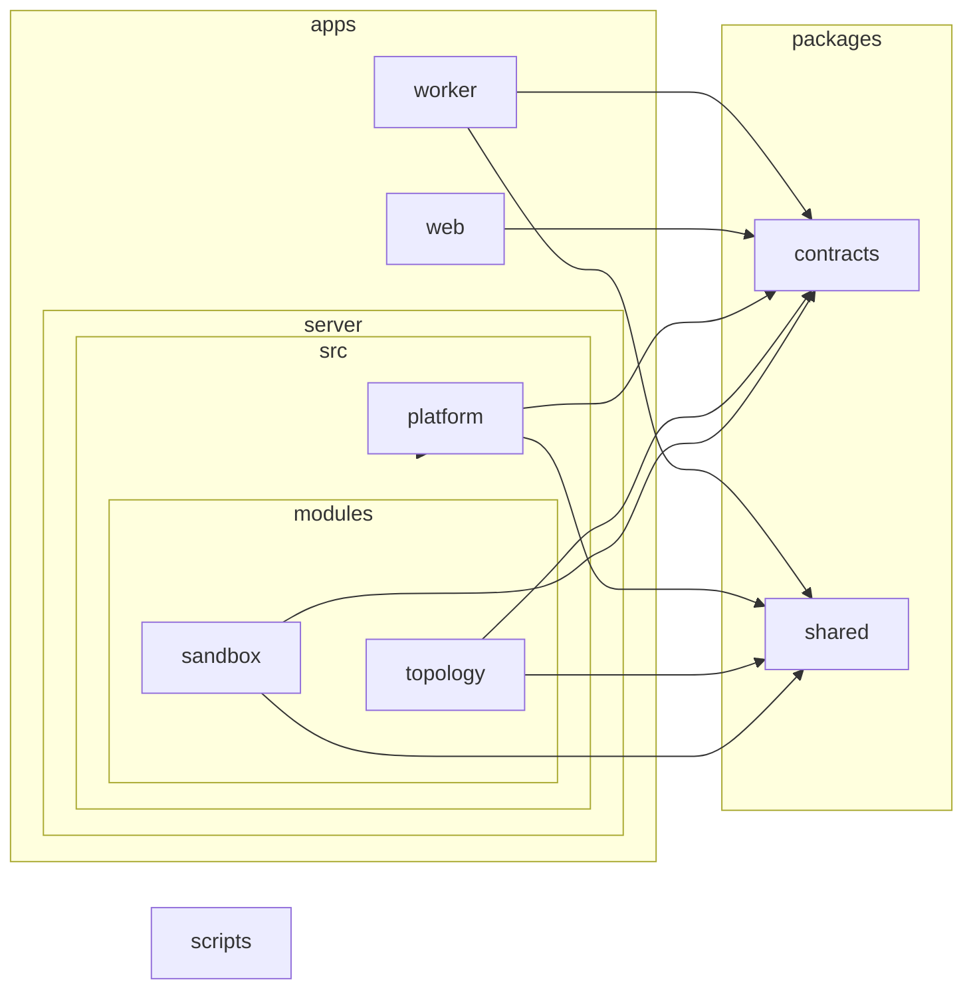

# Architecture

The full specification is section 5 of `docs/plan.md`. This page is the short version plus the generated module graph.

## Style

A modular monolith control plane plus a small data plane.

- Control plane: `apps/server`, one deployable application organized into capability modules with enforced boundaries. It validates input, orchestrates experiments, persists runs, talks to Meta and partner APIs, and serves the HTTP API.
- Data plane: the system under test and the measurement instruments. One worker process per topology node (`apps/worker`), one open-loop load generator process per experiment (`apps/loadgen`), and Toxiproxy. They are spawned and supervised by the control plane and are never on the control plane's request path. They are test subjects, not microservices.

## Workspaces

| Workspace | Role |
|---|---|
| `packages/contracts` | zod schemas and inferred types for every boundary, plus the catalog of numeric bounds. No business logic. |
| `packages/shared` | Tiny shared kernel: typed errors, result type, clock and random ports, seeded random. |
| `apps/server` | Control plane. `platform/` (config, logging, database, migrations, http-kit, lifecycle), `modules/` (capabilities), `main.ts` and `app.ts` (composition). |
| `apps/web` | React application. Sees only contracts. |
| `apps/worker`, `apps/loadgen` | Data plane programs (Phases 2 and 3). See only contracts and shared. |
| `scripts` | Provider smoke scripts. |
| `tools` | Boundary tests and the module graph generator. |

## Layers inside a module

`domain` (pure rules, imports only contracts and shared), `application` (use cases and ports), `infrastructure` (adapters that implement ports), `http` (thin controllers). Dependencies point inward. A module exposes only its `index.ts`.

## Allowed dependencies between modules

For each module, the other modules whose public API it may import (contracts and shared are always allowed). The source of truth is `tools/architecture/module-matrix.json`.

| Module | May import |
|---|---|
| `topology` | none |
| `chaos` | none |
| `sandbox` | topology |
| `measurement` | none |
| `runs` | none |
| `experiments` | topology, sandbox, chaos, measurement, runs |
| `meta-ai` | none |
| `repair` | topology, experiments, runs, meta-ai |
| `vision` | topology, meta-ai |
| `voice` | topology, meta-ai |
| `reporting` | runs, meta-ai |
| `benchmarks` | topology, experiments, repair, runs, meta-ai |

Only `topology` and `sandbox` exist so far. The other modules are created in the phase that implements them.

## Enforcement

`pnpm boundaries` runs the rules in `.dependency-cruiser.cjs`. `tools/architecture/boundaries.test.ts` proves each rule fires. `pnpm graph:check` fails when the graph below is stale.

## Module graph (generated)

Generated from the real source tree by `pnpm graph`. Edges show imports between workspaces and modules.

<!-- graph:start -->

<!-- graph:end -->
